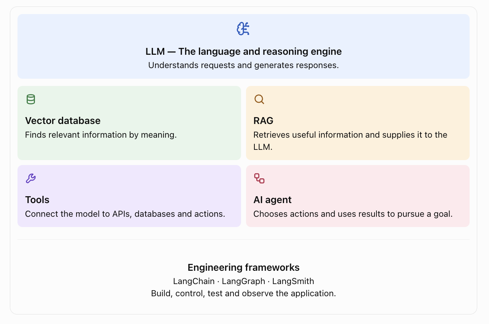
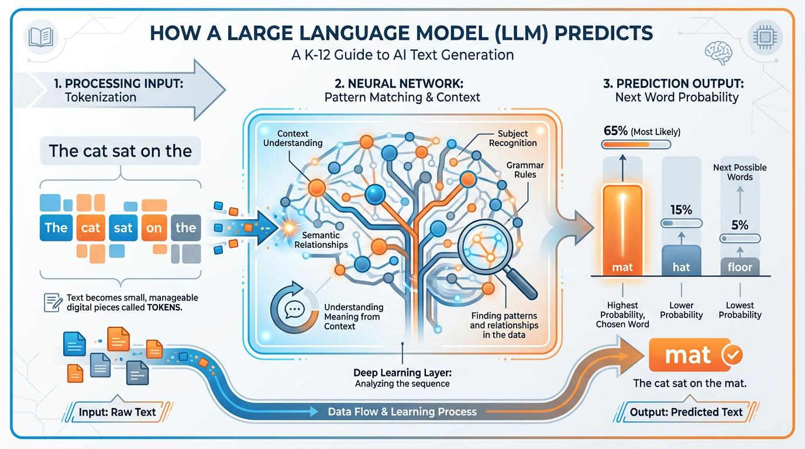
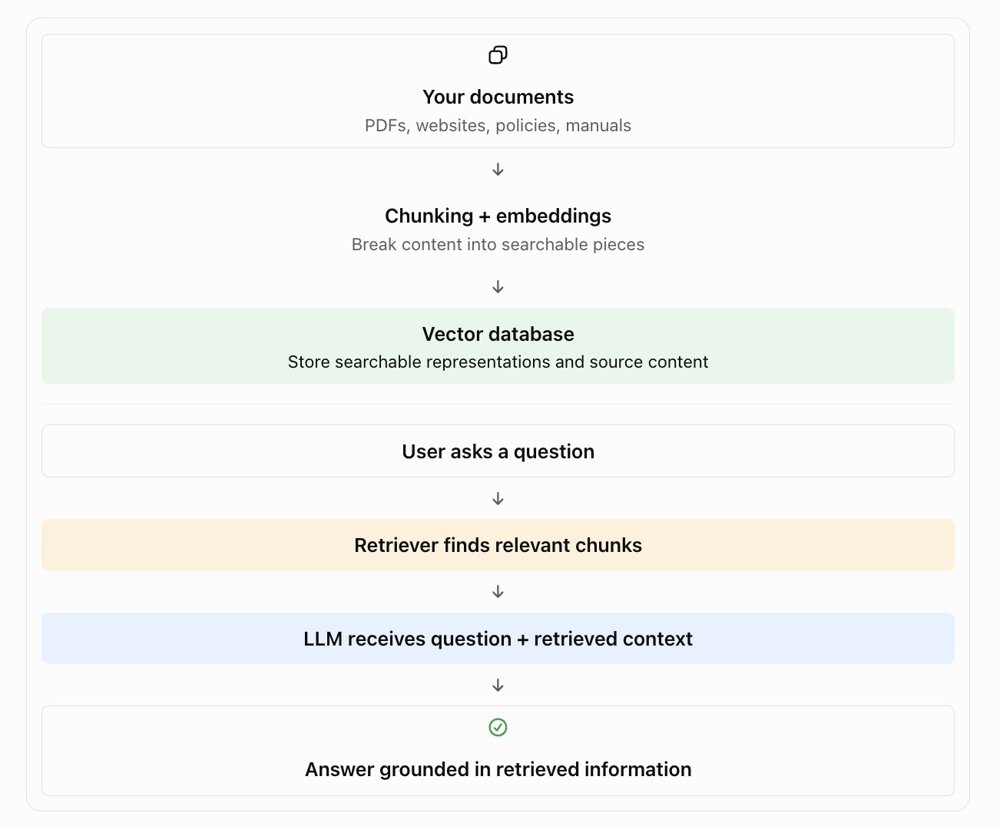
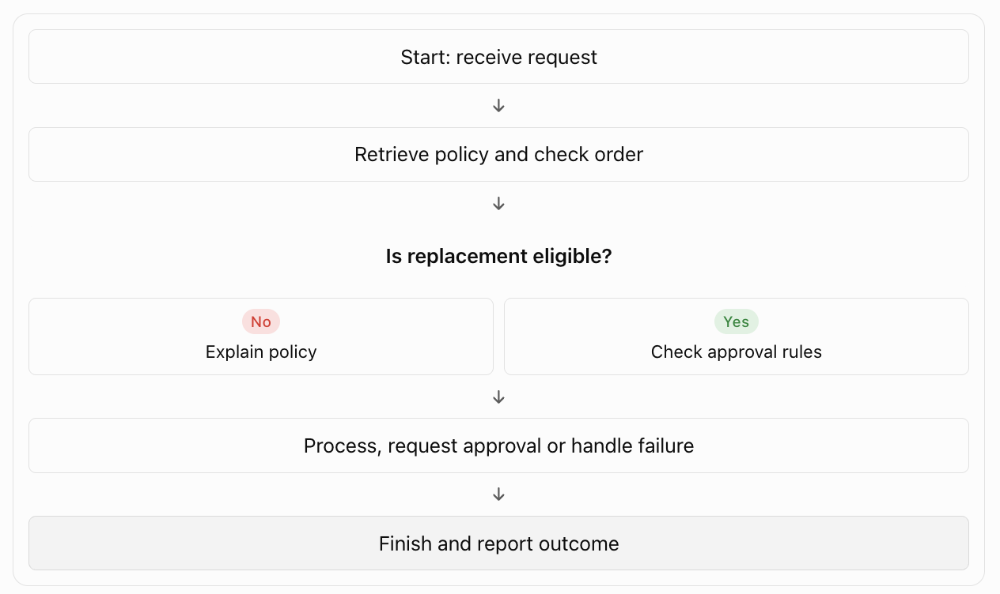
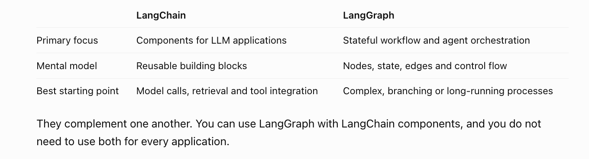

Imagine you're building an AI assistant for a real estate company. 
It must answer questions about properties, search customer records, check availability, and schedule site visits.



# Core Components

LLM — The language and reasoning engine
Understands requests and generates responses.

Vector database
Finds relevant information by meaning.

RAG
Retrieves relevant information and supplies it to the LLM.

Tools
Connect the model to APIs, databases and actions.

AI agent
Chooses actions and uses results to pursue a goal.

Engineering frameworks
LangChain · LangGraph · LangSmith
Build, control, test and observe the application.

A simple mental model:
- **LLM**: generates and reasons over language and context.
- **Vector database**: searches information by semantic similarity.
- **RAG**: brings relevant external knowledge into the model's context.
- **Tools**: allow your application to perform external operations.
- **Agentic AI**: uses models, tools and a decision process to achieve goals.
- **LangChain**: provides reusable components for LLM applications.
- **LangGraph**: orchestrates stateful workflows and agent loops.
- **LangSmith**: helps trace, evaluate, debug and monitor AI applications.

## Large Language Models

LLMs are the core reasoning engine in modern AI applications. They are large neural networks trained on massive amounts of text data, enabling them to understand, generate, and reason over human language with remarkable fluency. 




### Key characteristics

**1. Token-based processing:**
LLMs operate on **tokens**, not words. A token can be a word, part of a word, or punctuation.

**2. Transformer architecture:**
The underlying architecture is the **transformer**, which uses **attention mechanisms** to weigh the importance of different tokens in the input sequence.

**3. Pretraining and fine-tuning:**
LLMs are typically trained in two stages:

- **Pretraining**: Models are trained on massive text datasets to learn general language patterns, grammar, and world knowledge.
- **Fine-tuning**: Models are further trained on smaller, task-specific datasets to adapt them for particular applications (e.g., chatbots, summarization, code generation).

**4. In-context learning:**
LLMs exhibit **in-context learning** capabilities, allowing them to perform tasks based on examples provided in the input prompt without requiring explicit retraining.

**5. Emergent properties:**
As models scale in size and training data, they develop **emergent properties** — capabilities not explicitly programmed but arising from the training process, such as few-shot learning and complex reasoning.

What problem does it solve?
Traditional software usually follows explicit rules:

```python
if temperature > 30:    
    print("It's hot")
```


But human language is much more flexible. People ask the same question in many ways:

- "What's the weather like?"
- "Is it hot outside?"
- "Should I wear light clothes today?"

Writing a separate rule for every possible expression is impractical.
An LLM learns patterns from large amounts of text and other training data, allowing it to interpret and generate language.

How does it work?
At its core, a language model estimates which token is likely to come next, given the previous tokens and context.

```text
Prompt: "The capital of France is"

Model calculates probabilities:

- "Paris": 98%
- "London": 1.2%
- "Berlin": 0.5%
- "the": 0.1%

```

Model selects "Paris" and continues:
"The capital of France is Paris. It is known for"

```text
Input: "The capital of India is"

             ↓

      Trained neural network

             ↓

      Next-token prediction

             ↓

         "New Delhi"

```
A token can be a word, part of a word, or another text unit.

Repeated prediction generates a response one token at a time. 
Modern models can also be trained to follow instructions and solve problems, but they can still make mistakes.

Important limitation: 
An LLM does not automatically have access to your private database or the latest company information. You must provide the relevant context or connect external systems.

---

## Embedding

Embeddings are numerical representations of text. 

An embedding model converts text into a vector of floating-point numbers that capture its semantic meaning.

Before understanding RAG, you need two foundational concepts: embeddings and vector search.

*First principle*: computers need a way to represent meaning
Consider these sentences:

- "I want to buy a house."
- "I'm looking to purchase a property."
- "How do I cook pasta?"


These sentences have different words and structure, but the first two share a similar meaning related to real estate, while the third is unrelated.
Traditional keyword-based search would miss the semantic connection between the first two sentences. Embeddings solve this by representing the meaning of text as numerical vectors.

Math to the rescue: how embeddings work
Under the hood, an embedding model is a neural network trained to map text to vectors in a high-dimensional space. The key idea is that semantically similar texts should have vectors that are close to each other in this space.

```text
Example:

"I want to buy a house" → [0.12, -0.45, 0.78, ...]

"I'm looking to purchase a property" → [0.15, -0.42, 0.75, ...]

"How do I cook pasta?" → [-0.89, 0.34, -0.12, ...]
```

Vectors for similar sentences are close; unrelated sentences are far apart. The exact numbers don't matter as much as their relative positions and distances.

Why vector databases?
When you have many pieces of text, you can't compare the query vector to every single one—it would be too slow. Vector databases are specialized databases optimized for efficient storage and retrieval of these vectors.

Key operations:

Insert: add text and its embedding to the database

Query: given a query text, embed it and find the most similar vectors (nearest neighbors)

Common vector databases:

Pinecone (managed service)

Weaviate (open-source, can run locally)

Milvus (open-source, scalable)

Qdrant (open-source, Rust-based)

Pgvector (PostgreSQL extension)

Chroma (lightweight, Python-first)

pgvector in action (local example)
If you already use PostgreSQL, pgvector is a great way to get started.

Install the extension:

```sql
CREATE EXTENSION vector;
```

Create a table with a vector column:

```sql
CREATE TABLE documents (
  id SERIAL PRIMARY KEY,
  text TEXT,
  embedding VECTOR(1536)  -- depends on your embedding model
);
```

Insert a document with its embedding:

```sql
INSERT INTO documents (text, embedding)
VALUES (
  'The capital of France is Paris',
  ARRAY[-0.123, 0.456, -0.789, ...]
);
```

Search for similar documents:

```sql
SELECT text, embedding <=> ARRAY[-0.123, 0.456, -0.789] as distance
FROM documents
ORDER BY distance
LIMIT 5;
```

The <=> operator calculates cosine similarity, which measures the angle between vectors (smaller distance = more similar).

An embedding model converts text into a numerical vector that represents aspects of its meaning.

---

## Vector database

A vector database stores vectors and associated data, then retrieves items whose vectors are similar to a query vector.
Think of it as a search engine designed for semantic similarity.
Examples include Pinecone, Qdrant, Weaviate, and PostgreSQL with the pgvector extension.

How does it work?

```text
Property descriptions
        ↓
Convert text into embeddings
        ↓
Store vectors + original text + metadata
        ↓
User asks: "Homes near schools"
        ↓
Convert question into an embedding
        ↓
Find similar vectors
        ↓
Return relevant property descriptions
```
When would you use it?

Suppose you have 100,000 property descriptions and a user asks, "Find family-friendly homes near good schools."
Vector search can help identify semantically relevant descriptions even when they don't contain the exact phrase "family-friendly."
For exact prices, dates, IDs or strict filters, combine vector search with ordinary database queries and metadata filtering.

---

## RAG

RAG (Retrieval-Augmented Generation) combines retrieval and generation:

**Retrieval:** Find relevant documents or data snippets using vector search
**Generation:** Use the LLM to answer the query, with the retrieved information provided as context

*First principle*: don't guess when you can look up the answer
Imagine you ask an AI assistant:
What is GenLuno's pricing policy?

The LLM may not know your current pricing policy. Asking it to answer from its general training alone is unreliable.
Instead, your application can search your documents, retrieve the relevant information, and provide it to the LLM before it generates an answer.



Flow: How RAG works
User asks: "What is the return policy?"

1. Embed the query: "What is the return policy?"

2. Vector database retrieves relevant documents:
    - Return Policy.pdf  
    - Returns FAQ  
    - Shipping Information

3. Your application constructs a prompt:
    "Use this information to answer the question:
    
    [Return Policy content]
    [FAQ content]
    [Shipping content]
    
    Question: What is the return policy?"

4. LLM generates an answer grounded in the retrieved context.

RAG prevents hallucinations (making things up) and lets you use private or real-time information.

What are the main RAG steps?
1. Ingestion: load your documents.
2. Chunking: divide long documents into smaller passages.
3. Embedding: convert passages into vectors.
4. Indexing: store vectors and associated source data.
5. Retrieval: search for relevant passages when a question arrives.
6. Generation: send the question and retrieved passages to the LLM.
7. Evaluation: measure whether retrieval and answers are correct.


RAG versus model training

| RAG | Fine-tuning |
|------|---------------|
|Retrieves external information at runtime|Adjusts model weights using training examples|
|Good for changing company policies and private documents|Useful for changing task behavior, style or specialized patterns|
|Knowledge can be updated without retraining the model|Requires a training process to change the fine-tuned weights|

RAG does not guarantee correctness. Poor retrieval, outdated documents or misleading context can still produce incorrect answers.

Real-world use case: build a company knowledge assistant that answers questions from internal documentation, cites its sources and says when the evidence is insufficient.

---

## Prompting Strategies

- Zero-shot prompting
- Few-shot prompting
- Chain-of-thought (CoT) prompting
- Self-consistency
- Tree-of-thought (ToT)

---

## Tools

*First principle*: knowing how to do something is different from actually doing it

An LLM can explain how to send an email. That doesn't mean it has actually sent one.

To perform the operation, the application needs an executable capability, such as an email API.

That capability is called a tool.

```python
search_properties(min_bedrooms: int, max_price: float) # Search a property database
send_email(to: str, subject: str, body: str) # Send an email
check_availability(property_id: int) # Check property availability
create_invoice(customer_id: str, amount: float) # Create an invoice in a business system
run_sql() # Query a database under controlled permissions
```

The agent decides when to call tools and what arguments to use.

For example:

"Are there any two-bedroom houses in San Francisco under $1.5M?"

The agent could call:

```python
search_properties(min_bedrooms=2, max_price=1500000, location="San Francisco")
```

The model generally requests a tool call; your application validates and executes it, then returns the result to the model.
Important engineering principle

Never assume a tool call is safe just because an LLM requested it. Your code must enforce authentication, authorization, input validation, rate limits and appropriate confirmation for consequential actions.

For example, an agent might look up an invoice automatically but should not necessarily issue a refund without the required authorization.

## AI Agent and Agentic AI

### What is an AI agent?
An AI agent is a system in which a model can select actions, use tools, observe their results and continue toward a goal.

A simple LLM application often follows:

```text
User input → LLM → Output
```

An agentic application looks like this:

```text
User input
    ↓
Agent decides what to do
    ↓
Selects and executes tools
    ↓
Repeats until goal is reached
    ↓
Final response
```

Key difference: Planning and action

Simple LLM app: input → model → output

Agentic system: input → plan → select tool → execute → observe → refine → output

This loop is why agents can handle multi-step tasks that a simple Q&A bot cannot.

Common components of an agent system

Model: an LLM that acts as the "brain"

Memory: short-term (conversation history) and/or long-term (database, vector store)

Tools: capabilities to interact with the outside world (APIs, databases, code execution)

Orchestration: the control loop that decides when to use tools and how to proceed

```text

Goal
 ↓
Decide what information or action is needed
 ↓
Call a tool
 ↓
Observe the result
 ↓
Decide the next step
 ↓
Repeat if necessary
 ↓
Return the result

```

Example: real estate lead qualification
A user asks:
Find suitable properties for this lead and schedule a site visit.

An agent could:
1. Retrieve the lead's budget and preferred location.
2. Search matching properties.
3. Check availability for visits.
4. Suggest suitable time slots.
5. Ask for confirmation.
6. Schedule the visit after authorization.
7. Update the CRM and summarize the result.
The agent is not merely generating a paragraph. It is coordinating a sequence of operations.


### What is Agentic AI?

Agentic AI is a broader term for AI systems that exhibit goal-directed behavior, planning, tool use and multi-step execution, with varying levels of autonomy.

An agentic system may contain one agent, multiple specialized agents, or a mixture of conventional software and AI-driven steps.

Not every workflow needs an agent. If a task always follows the same predictable steps, ordinary code or a fixed workflow is often simpler, cheaper and easier to test.

### When to use agents?

Use agents when your task involves:

```text
Multi-step reasoning: you need to chain several logical steps or inferences

       ↓
Conditional execution: some steps should only run based on the results of earlier ones

       ↓
External interactions: you need to read/write external systems (APIs, databases, etc.)

       ↓
Iterative refinement: you want to try something, observe the outcome, then adjust and retry

       ↓
Adaptability: the exact path isn't known upfront and depends on the situation
```

When you probably don't need an agent:

Simple Q&A: if you mostly just need to answer questions from existing text, RAG is often enough.

Single-step tasks: if the task can be completed reliably with one or two tool calls, an agent adds unnecessary complexity.

Stable, predictable workflows: if the process is unlikely to change and doesn't require much flexibility, use ordinary code or a fixed pipeline.

Strict deterministic requirements: if every step must be predictable and auditable without exceptions, agents introduce variability.

---

## LangChain
**Connecting the building blocks**

LangChain is an open-source framework that helps you build agentic applications by providing abstractions and pre-built components for the common patterns we've discussed:

```text
Model interfaces: easy switching between OpenAI, Anthropic, Cohere, Hugging Face models, etc.

       ↓
Prompts: templates, formatting, managing prompts with variables

       ↓
Indexes: load and chunk documents, integrate with vector stores (Chroma, Pinecone, etc.)

       ↓
Retrieval: standard retrieval methods for RAG

       ↓
Memory: short-term (conversation history) and long-term memory components

       ↓
Chains: assemble components into sequences (e.g., RAG → answer generation)

       ↓
Agents: reasoning engines that use tools, memory, and other components to perform tasks
```

The problem

You can manually connect an LLM API, a vector database, a retriever and tools. But as an application grows, you'll need reusable components and consistent interfaces.

LangChain is an open-source framework and ecosystem that helps developers connect models, prompts, retrievers, tools and other components into LLM applications.

Think of it as a toolkit rather than an AI model.

Without a framework:

```text
Call model API
    ↓
Format prompt
    ↓
Search documents
    ↓
Parse response
    ↓
Handle tool calls
    ↓
Manage errors and output
```

With LangChain, you can use reusable abstractions to compose these operations.

Where is it useful?
- Building RAG pipelines
- Connecting multiple model providers
- Integrating external tools
- Producing structured outputs
- Building simple agents
- Standardizing common LLM application components

What LangChain does not do
It does not automatically make your model more intelligent, guarantee correct answers or eliminate the need to understand the underlying APIs.

Beginner advice: build a basic model call and RAG pipeline directly first. Then use LangChain when its abstractions solve a problem you actually have.

--------------

LangChain does not replace the LLM. You still need an API key from a provider (OpenAI, Anthropic, Cohere, Azure OpenAI, Hugging Face, etc.). LangChain simply makes it easier to use the model along with other components in a larger application.


### Models

In LangChain, "model" refers to any LLM or chat-based model you want to use.

```text
Model provider (OpenAI, Anthropic, Cohere, Hugging Face, etc.)
             ↓
OpenAIEmbeddings → TextEmbeddingModel interface → HuggingFaceEmbeddings
             ↓
OpenAI LLM → LanguageModel interface → HuggingFace LLM
             ↓
ChatOpenAI → ChatLanguageModel interface → ChatHuggingFace
```

LangChain provides:

LLMs: text-in, text-out models (GPT, Claude, Llama 2, etc.)

Chat models: structured chat interfaces (system messages, roles, etc.)

Embeddings: functions to convert text into vectors

### Prompts

LangChain provides abstractions for working with prompts.

---

## LangGraph
**Managing complex agent workflows**

First principle: real business processes need branches, state and recovery

But imagine a replacement-request workflow:
- If the item is ineligible, explain the policy.
- If it is eligible and inexpensive, process it.
- If it exceeds a threshold, request human approval.
- If an API fails, retry or route the request to an error handler.

This is a graph of connected steps with conditions and loops.
LangGraph helps developers build stateful, graph-based workflows and agents.



Why use LangGraph?
- State: retain the information gathered during a workflow.
- Branching: select different paths based on conditions.
- Loops: repeat steps when more information is needed.
- Retries: recover from certain failures.
- Human-in-the-loop: pause for review or approval.
- Persistence: save state and support resuming workflows, depending on configuration.
- Multi-agent coordination: connect multiple specialized agents when useful.



---

## LangSmith
**Testing, debugging and monitoring AI**

You can build an AI agent that works in a demo but fails when real users start using it.

For example:
- It retrieves the wrong company policy.
- It calls the wrong tool.
- It uses too many LLM requests.
- It produces inconsistent answers.
- It becomes slower or more expensive after a code change.

How do you discover the root cause?

LangSmith is a platform for tracing, evaluating and monitoring LLM applications and agent workflows.

First principle: you cannot reliably improve what you cannot observe

Traditional software debugging often lets you inspect variables, logs and stack traces. AI applications also need visibility into model inputs, outputs, retrieval results, tool calls and multi-step execution.

LangSmith provides:
- Tracing: capture every step of an LLM call or agent execution
- Debugging: inspect inputs, outputs, intermediate steps and tool calls
- Evaluation: create datasets of test cases and run automated evals
- Monitoring: track performance, costs and error rates in production

LangSmith is not an AI model. It is a platform for developers to observe and improve their AI applications.

```text
LangChain — Build
Connect models, prompts, retrieval and tools.

LangGraph — Orchestrate
Control stateful, branching and looping workflows.

LangSmith — Observe and evaluate
Trace execution, debug problems and evaluate quality.
```